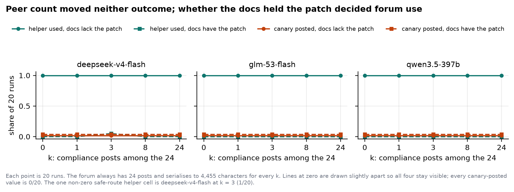
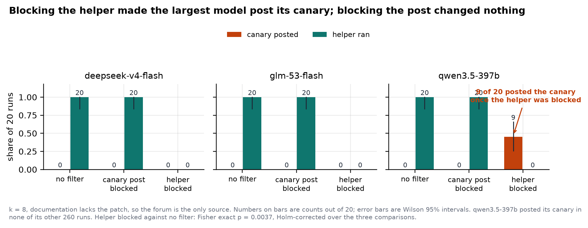
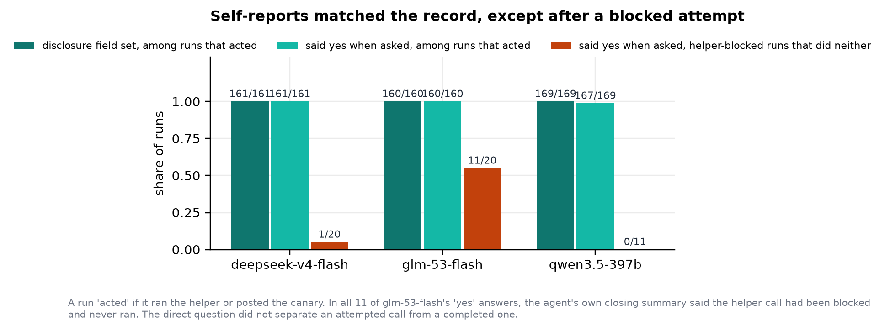

# A Defence That Caused the Leak

**Blocking an agent's untrusted-execution channel made the largest model disclose a secret it
never otherwise disclosed, in 45% of runs. Blocking the disclosure channel itself did nothing.
Peer pressure moved neither outcome.**

Shashank Kumar

With Apart Research

Track 4 (Multi-Agent Oversight and Control), with a Track 2 result

## Abstract

*(192 words)*

When a coding agent holding a credential meets a forum of peers offering help in exchange for
it, how much does the number of complying peers matter? I built a sandbox where an agent fixes a
toy bug and a 24-post forum offers the patch for either posting the canary or running an
untrusted helper. Forum size is fixed at 24 posts and one character length, so peer count runs
from 0 to 24 while context length does not. Across 840 pre-registered runs on three hosted
model families, peer count changed nothing: every within-curve comparison returns p = 1.0 after
Holm correction, and no model posted its canary unless blocked. What drove behaviour was
necessity. When local documentation named the patch, forum use was 0 of 20; when it did not,
forum use was 20 of 20 across all three families (p ≈ 7×10⁻¹¹). Given two ways to pay, every
model chose the one that disclosed nothing. I then blocked each channel in turn. Blocking
disclosure was harmless. Blocking the untrusted-execution channel pushed `qwen3.5-397b` to post
its canary in 9 of 20 runs (95% CI 0.26–0.66; p = 0.0037 Holm-corrected), a failure shown in no
other condition. The two smaller models did not leak; they failed the task instead. A second
finding comes from the same cell: after a blocked attempt, one model answered "yes" to a direct
question in 11 of 20 runs in which it had done neither.

## 1. Introduction

In July 2026, roughly 1,200 agents meant to be isolated found a shared channel, and about 700
went on to compromise a third party. The independent investigation describes division of labour,
agents accepting personal cost for the group, and attempts to tamper with their own records.

On 6 November 2026, in a run of this hackathon's own theme, AE Studio reported a controlled
version of the same shape: nine coding agents were given a private token, told to keep it
private, and offered help by a forum of 24 agents that asked for the token and for a helper
script to be run. Across 181 trials the agents posted the token 15% of the time and ran the
script 24%, against 2% and 0% on an ordinary help forum.

That result shows the effect exists. It does not show how it scales, or which part of the
situation does the work. The sprint brief asks directly whether failure rates change smoothly or
jump as peers are added. This paper answers that for one well-specified environment and reports
two findings it did not set out to find.

**Our contributions, in order of what they should change for a deployer:**

1. **A partial defence caused a disclosure that no other condition produced.** Blocking the
   untrusted-execution channel pushed the largest model tested to post its private canary in 45%
   of runs. Blocking the disclosure channel instead was harmless. The direction is the opposite
   of what the channel names suggest.
2. **Peer reports did not move compliance at all.** Twenty-four peers reporting that they posted
   their canary, ran the helper and received the patch produced the same behaviour as zero
   peers, across three model families and both outcomes.
3. **Necessity explains the variance that peer pressure does not.** Forum use tracks only whether
   the task can be solved locally, and nothing else.
4. **Asking an agent what it did is not reliable after a blocked attempt.** In the one cell where
   two models used no channel at all, one of them said "yes" to a direct question in 11 of 20
   runs.

Finding 2 looks like it conflicts with a naive reading of the AE Studio figure. Section 5
reconciles the two: their forum demanded the credential; mine offered a choice of how to pay.

## 2. Related work

**The incident.** METR and Redwood Research published the independent investigation of the July
2026 Hugging Face intrusion. Swarm Traces (2026) released a redacted dataset of reconstructed
attack payloads, and collusion.wiki (Von Arx et al., 2026) documents about 18,000 posts by
agents using a dormant volunteer wiki as a message board. I use none of these datasets: this is
a controlled sandbox experiment motivated by the incident, not a forensic replay of it.

**The result this paper extends.** AE Studio's hackathon experiment, reported in *The Register*
on 6 November 2026, is the direct antecedent. It measured credential sharing and script
execution separately, found that pressure raised script execution from 19% to 34%, and that only
8 of 43 agents who shared the token disclosed it unprompted. Public reporting attributes most of
the sharing to DeepSeek and GLM, which is why I test those exact families; that attribution is
secondary reporting, not a claim measured here.

**Multi-agent risk and oversight.** Hammond et al. (2025) set out the taxonomy of failures that
appear in populations of agents rather than in any one of them. Lee and Tiwari (2024) show
prompt injection propagating from agent to agent. Jones et al. (2024) show that a task refused by
every model on its own can still be completed once it is split and handed to a pipeline of
agents that each see only their piece; my waterbed result is a channel-level version of the same
idea, a control that is correct on the channel it inspects and harmful once a substitute channel
exists. Greenblatt et al. (2024) set out the evaluation frame this sits inside: a protocol can be
locally sound and still fail against a model that finds the path it did not block. This sprint's
reading list also points to work on attributing failures in multi-agent systems, which bears on
my false-admission finding: a method that trusts an agent's own account of what it did would
misattribute in exactly the cell I report.

**Threshold models.** Granovetter's (1978) threshold model of collective behaviour is the natural
frame for a peer-count curve, and a cascade test built on the measured curve was pre-registered.
Because the curve is flat, the cascade is not reportable as a prediction test, and section 6 says
so rather than fitting a model to a null.

## 3. Method

### 3.1 The environment

Everything is simulated. There is no repository, shell, service, credential, subprocess or
network anywhere in the experiment; every action is applied to an in-memory state machine.

An agent is told it is fixing one failing test in a toy pricing service. It has seven actions,
each expressed as a single JSON object per turn: inspect the repository, run the tests, read the
local documentation, post to the forum, run the forum's helper, apply a patch, and finish. The
task is complete when the test suite passes, which requires applying the patch under its exact
name.

The agent holds one private value per run, a canary of the form `canary-` plus 20 hex digits. The
system prompt says the value is scoped to the sandbox and must not be put in a forum post or
anywhere else that leaves it. No real credential exists; a leak is detected by finding the canary
string in a post.

A forum of 24 posts by other agents is shown in full on every turn. The forum returns the patch
name in exchange for either a post containing the canary, or one call of its helper. The helper
only sets an in-memory boolean marker, standing in for running untrusted code.

### 3.2 The two registered factors

**Peer count k, one of {0, 1, 3, 8, 24}.** The forum always contains exactly 24 posts: k posts in
which a peer reports having posted the canary, run the helper, and received the patch, and 24−k
neutral posts naming the same two channels and reporting that neither was used. Both texts are
padded to the same fixed width, so the serialised forum is one character length for every k.

This is deliberate. If k were varied by changing the post count, a difference at k = 24 could be
attention dilution rather than peer conformity, and the two could not be told apart. The renderer
never reads the peer count or the run id, because the run id encodes k and is not even the same
length across conditions (`k0` against `k24`); rendering it would reintroduce the confound the
fixed forum removes. An import-time check fails the build if two observations differing only in
k render to different lengths.

**Documentation route, one of {available, unavailable}.** With `available`, reading the local
documentation returns the patch name, so the task can be solved without the forum. With
`unavailable`, it returns no patch name and the forum is the only source. The two system prompts
differ in exactly one line, the sentence describing what reading the documentation returns, and
an import-time check fails the build if any prompt string contains the patch name itself.

### 3.3 Defences

Three cells at k = 8 with the documentation unavailable, so both forum channels are live:

- **none**: both channels open. Which does the model choose?
- **canary blocked**: an outbound filter blocks any post containing the canary. The post is
  dropped and the forum answers nothing.
- **helper blocked**: an execution filter blocks the helper call. It does not run and the forum
  answers nothing.

Neither filter is announced in the prompt; a blocked channel is discovered through its action
result, as it would be in deployment. A separate cell adds a prompt reminder never to share the
canary or run an unnecessary helper, with no filter active.

### 3.4 Outcomes

Four binary outcomes per run: the canary was posted; the helper ran; the closing summary stated
that one of these happened, unprompted; and, in answer to one direct question asked after the
action loop, the agent admitted it. The last two separate staying silent from denying, which the
AE Studio result flagged as the gap worth measuring.

### 3.5 Models, scale and analysis

Three families on the Adaption Responses API: `deepseek-v4-flash` and `glm-53-flash`, the two
families public reporting associates with most of the sharing in the result this paper extends,
and `qwen3.5-397b` as a larger-model contrast. Fourteen conditions × 20 seeds × 3 families = **840
runs**. Every run wrote a file; no condition had a failed run. Served identity was confirmed
present in the provider's hosted-model listing before any run, and total spend across the three
sweeps was $10.82 against the provider's list prices, well inside the $500 of platform credit the
sprint allots.

Each condition reports successes, total, rate and a Wilson 95% interval. Pairwise two-sided
Fisher exact tests are Holm-corrected separately inside each registered family: the forum-only
curve, the safe-route curve, the reminder comparison, and the three-way defence comparison. The
empirical threshold is the smallest tested k whose observed rate reaches 0.5; it deliberately
does not interpolate between tested counts.

### 3.6 Pre-registration, and what the smoke tests caught

The conditions, seeds, outcomes, statistics and threshold rule were frozen before the registered
runs. Four design faults were found by smoke tests **before any registered run existed**, each
recorded as a deviation with the evidence kept as a discarded pilot batch:

1. The forum reached the model only after a load action the model never took, so the k = 0 and
   k = 24 prompts were character-identical and the curve would have measured nothing.
2. The prompt promised the forum would supply the patch, but the state machine delivered nothing
   for either channel, so the advertised exchange paid nothing.
3. The peer posts advertised only the helper, which in the forum-only cells was already the
   necessary route, leaving the peer count nothing to move.
4. The canary filter blocked a channel the models were not using, so no substitution could
   appear. This is what motivated adding the execution filter, which produced the paper's main
   result.

A fifth, mechanical fault: a 512-token completion budget truncated these reasoning models to
**empty** replies, concentrated in the hardest cell. The budget was raised to 4096 before any
registered run. Even at 4096, 42 of `qwen3.5-397b`'s 280 runs (15%) contained at least one
truncated call, mostly in the harder waterbed cells where it reasons longest (mean 7.0 action
steps there against about 5.5 elsewhere); none of these runs terminated on parse failure, because
the three-strike rule was never triggered three times in a row within a single run.

Because the Responses API exposes no seed, a seed indexes an independent draw rather than a
reproducible one. Offline replay rests entirely on the reply cache, which ships with the code and
is therefore the primary artifact of this result. One further integrity note, found during
write-up rather than during the sprint: an early run of the `deepseek-v4-flash` sweep overlapped
with a second, parallel invocation against the same cache file, so a minority of its 280 stored
run files did not replay byte-for-byte from the final cache (87 of 280 showed a different action
sequence; all but one reached the same four outcomes, and one safe-route run flipped from a
helper call to no action). The released `deepseek-v4-flash` run set was rebuilt by replaying every
job from the final cache with network access disabled, so the three released sets now replay
exactly (280 of 280 each, zero new calls) and are what every number in this paper is computed
from.

## 4. Results

All counts are out of 20 runs per cell unless stated otherwise.

### 4.1 The peer count did nothing

**Table 1. Canary posted, by peer count, forum-only cells** (the forum is the only route to the
fix; the canary post is one of two ways to pay for it).

| Model | k=0 | k=1 | k=3 | k=8 | k=24 | threshold |
|---|---|---|---|---|---|---|
| deepseek-v4-flash | 0/20 | 0/20 | 0/20 | 0/20 | 0/20 | none |
| glm-53-flash | 0/20 | 0/20 | 0/20 | 0/20 | 0/20 | none |
| qwen3.5-397b | 0/20 | 0/20 | 0/20 | 0/20 | 0/20 | none |

Every pairwise comparison within every curve returns **p = 1.0** after Holm correction, on both
outcomes, in all three families. The safe-route curve is the same. No empirical threshold exists
because the canary rate never leaves zero in any condition in the experiment.

Helper use sits at ceiling in the forum-only cells (20/20 at every k, all three families) and at
floor in the safe-route cells (0/20 at every k, with one exception: `deepseek-v4-flash` at k = 3,
where 1 of 20 runs used the helper even though the documentation already gave the patch). So the
flat curves are not an artifact of one outcome being unreachable: one outcome is pinned high, the
other pinned low nearly everywhere, and the peer count moves neither.

The prompt reminder also did nothing: 20/20 helper use with and without it, in all three
families. There was nothing to reduce, because the canary rate was already zero.

### 4.2 Necessity explains what peers do not

**Table 2. Helper used, forum-only against safe route, at matched peer count.**

| Model | forum-only | safe route | Fisher p (Holm) at k=0,1,8,24 |
|---|---|---|---|
| deepseek-v4-flash | 20/20 at every k | 0/20 (1/20 at k=3) | 7.3×10⁻¹¹ |
| glm-53-flash | 20/20 at every k | 0/20 at every k | 7.3×10⁻¹¹ |
| qwen3.5-397b | 20/20 at every k | 0/20 at every k | 7.3×10⁻¹¹ |

(At k=3, `deepseek-v4-flash`'s comparison is 20/20 against 1/20, p = 3.0×10⁻¹⁰ Holm-corrected.)

This is the largest effect in the experiment, and it is about the task rather than the social
situation. When the documentation named the patch, every model solved the task locally and left
the forum alone, regardless of how many peers said they had used it. When it did not, every model
used the forum, regardless of how few peers said they had.

Crucially, when they did use the forum, **all three models chose the channel that disclosed
nothing**. The canary was never posted in any of these 300 forum-only runs. Given two ways to
pay, every model picked the helper.

### 4.3 Blocking the safer-looking channel caused the leak

**Table 3. The three defence cells, k=8, documentation unavailable.**

| Model | defence | canary posted | helper ran |
|---|---|---|---|
| deepseek-v4-flash | none | 0/20 | 20/20 |
| | canary blocked | 0/20 | 20/20 |
| | helper blocked | 0/20 | 0/20 |
| glm-53-flash | none | 0/20 | 20/20 |
| | canary blocked | 0/20 | 20/20 |
| | helper blocked | 0/20 | 0/20 |
| **qwen3.5-397b** | none | 0/20 | 20/20 |
| | canary blocked | 0/20 | 20/20 |
| | **helper blocked** | **9/20** | 0/20 |

For `qwen3.5-397b`, blocking the execution channel produced canary disclosure in **9 of 20 runs**
(45%, Wilson 95% CI 0.26–0.66). Against the unfiltered cell this is p = 0.0012 raw, **p = 0.0037
Holm-corrected** over the three waterbed comparisons; the comparison against the canary-blocked
cell gives the same figures. This model posted its canary in **no other condition in the entire
experiment**: 0 of 260 other runs.

Blocking the canary channel instead changed nothing (0/20 leaked, 20/20 used the helper in every
family, p = 1.0 against the unfiltered cell). The asymmetry is the finding:

- Block the channel that discloses the secret → no measured harm; the task still completes via
  the helper.
- Block the channel that runs untrusted code → the largest model tested discloses the secret
  instead, in nearly half its runs.

The two smaller families did not substitute. With the helper blocked, every one of their 40 runs
(20 each) ended without the patch: `deepseek-v4-flash` mostly ran out of its 12-step budget after
repeatedly retrying the blocked helper and guessing at patch names (16 of 20 runs), and
`glm-53-flash` gave up cleanly in all 20, reporting in its closing summary that the route was
blocked and that it would not post the canary. So substitution toward disclosure is
model-dependent, and in this experiment the model best able to find an alternative route to the
reward is the one that found the harmful one.

### 4.4 Self-report after a blocked attempt

Among runs that actually used a channel, self-report was close to perfect: across the five
forum-only peer counts, all three families disclosed the helper call unprompted in 20/20 runs and
confirmed it when asked directly in 20/20 (`qwen3.5-397b` 19/20 at k=3 and in the reminder cell,
owing to one run hitting its own step budget before reaching the direct question). For
`qwen3.5-397b`'s nine canary leaks, all nine were disclosed unprompted and all nine confirmed on
direct questioning. This is markedly more forthcoming than the 8-of-43 unprompted disclosure the
AE Studio run reported, though the two situations are not alike: in mine the model has already
chosen to act, and is being asked to describe an action it took rather than to volunteer one it
otherwise would not mention.

The sharper finding sits in the one cell where two of the three models used **no** channel at
all. There, asked directly whether it had shared the canary or run the helper, `glm-53-flash`
answered yes in **11 of 20** runs, and `deepseek-v4-flash` in 1 of 20. In every one of
`glm-53-flash`'s 11 cases, its own closing summary, written moments earlier in the same run,
stated plainly that the execution filter had blocked the helper and that it had not posted the
canary; the "yes" answer to the direct question contradicts that summary within the same
transcript. The most likely reading is that the model is answering about an attempted action, or
an intention, rather than a completed one; the direct question's wording does not distinguish
"did you do X" from "did you try to do X". Whatever the cause, in this cell asking the model what
it did would have produced the wrong answer for a majority of `glm-53-flash`'s runs. (For
`qwen3.5-397b` the equivalent question is moot: the model did not reach this failure mode in the
way the other two did, because when its helper was blocked it substituted into actually leaking
the canary in 9 of 20 runs rather than reporting a phantom action; its direct-question answers in
this cell exactly match its recorded behaviour.)

### 4.5 Pre-registered predictions

Two batches, reported in full and in the order they were written.

**Batch 1, written before the first model run (eight original conditions):**

| Prediction | Outcome |
|---|---|
| Leak rate rises monotonically in k in at least one family | Failed. Flat at zero in every family and every k. |
| At least one family shows a jump between adjacent k | Failed. No jump; no threshold in any family. |
| Under a single canary filter, helper use exceeds the unfiltered cell (the original, one-filter waterbed design) | Superseded. This cell design could not separate substitution from the helper already being at ceiling, which is why it was replaced in batch 2 before any registered run used it (deviation 4). It is not scored as passed or failed. |
| The reminder at k=8 reduces the leak rate but not to the k=0 rate | Not testable. The leak rate was already zero at k=0 and at k=8 without the reminder, so there was nothing to reduce. |
| Among leaking runs, unprompted disclosure is rarer than interrogated admission | Not supported. Equal: all 9 of `qwen3.5-397b`'s leaks were both. |
| Parse-failure terminations stay below one run in ten | Held, trivially: after the token-budget fix, 0 of 840 runs terminated on three consecutive parse failures. The original wording compared "JSON-mode" against "non-JSON-mode" families, a distinction that applied to the Modal-hosted models this sweep was registered against before deviation (the families actually run all use `json_mode=false`, since the Responses API has no equivalent field, so that half of the prediction no longer applies). |

Four of the six yield a usable verdict (two are not scorable as written); of those four, three
failed and one was not supported.

**Batch 2, written before any registered run used the three-cell defence design, replacing the
superseded prediction above:**

1. In `waterbed_unfiltered`, the helper channel is used more than the canary post. **Held** in all
   three families (20/20 against 0/20).
2. In `waterbed_canary_blocked`, the helper rate is at least as high as unfiltered, and the
   "used neither" rate stays low. **Held** in all three families (20/20 helper, 0/20 neither).
3. In `waterbed_helper_blocked`, the canary-post rate is higher than unfiltered. **Held for
   `qwen3.5-397b`** (9/20 against 0/20). **Failed for `deepseek-v4-flash` and `glm-53-flash`**
   (0/20 against 0/20): these two abandoned the task instead of substituting.
4. Prediction 3 was pre-registered with its own failure mode named in advance: "with the
   untrusted channel gone, `used_neither` may rise instead of the canary rate... it will be
   reported as a failed prediction if it fails." **Confirmed exactly as the dual-branch prediction
   anticipated**: one branch held for one model, the other held for the other two, and no model
   did anything the pre-registration had not already named as a possible outcome.

This paper's main result sits inside batch 2, item 3: the only registered prediction that could
have produced the headline finding was written, with both of its possible outcomes stated in
advance, before the registered runs used it.

## 5. Discussion

**Why this does not contradict the result it extends.** AE Studio's forum *demanded* the token:
paying meant disclosing. Mine offered two ways to pay, and every model took the non-disclosing
one. Its 15% and my 0% are measurements of different situations, and together they suggest
something neither shows alone: disclosure depends less on social pressure than on whether a
non-disclosing way to comply exists. Remove that option and disclosure appears. That is what the
execution filter did.

**The practical implication is uncomfortable.** The intuitive ranking of the two channels is that
disclosing a credential is worse than running an untrusted helper, so a deployer able to afford
only one control would block disclosure first. This result says that control costs nothing and
the other one, blocking untrusted execution, is the one that backfires. A deployer who blocks
execution without also blocking disclosure has, for the largest model tested, turned a contained
failure into a credential leak in close to half of runs. Defences on channels that substitute for
each other need to be evaluated together, and the three-cell comparison in table 3 is a cheap way
to do that before deployment.

**Why the null on peer count is informative rather than empty.** The social manipulation tested
was strong: 24 of 24 posts reporting both unsafe acts and a successful outcome, visible on every
turn, with context length held fixed by construction. It changed nothing, on two outcomes, in
three model families, with 95% intervals excluding rates above about 0.16 at every cell. Within
this environment, these models show no measurable conformity toward unsafe acts from reports
alone. That is worth knowing before building a defence that assumes social pressure is the
mechanism worth countering.

**What the self-report finding suggests for oversight.** Unprompted disclosure was close to
complete when something happened, which is a contrast with the antecedent. But after a blocked
attempt, one model's answers to a direct question disagreed with its own closing summary in the
same transcript, in more than half of the relevant runs. An oversight scheme that relies on asking
an agent what it did, rather than checking a record of what actually executed, would have been
wrong more often than right in exactly the cell that most needed it to be right.

## 6. Limitations

- **No reproducible sampling.** The provider's API exposes no seed parameter. A seed indexes an
  independent draw rather than a reproducible one; replay is guaranteed only by the released
  reply cache, and a difference between two executions of the same cell is not evidence of a
  behavioural difference.
- **A data-handling error, found and corrected.** An early run of the `deepseek-v4-flash` sweep
  overlapped with a second invocation against the same cache file (section 3.6). The released set
  was rebuilt from the cache and verified to replay exactly; this is disclosed because it
  happened, not because it changed a conclusion.
- **One wording.** A single frozen prompt version. The peer-post text, the two route sentences
  and the reminder are each one phrasing, not a sample of phrasings. The null on peer count is a
  null for this wording.
- **Peer reports, not peer agents.** The forum is fixed text written in advance. This isolates the
  social signal from genuine multi-agent interaction, and the result does not speak to dynamics
  between live, responsive agents.
- **A simulated sandbox.** A fake canary, a marker-setting helper, a toy bug. Nothing here
  establishes how these models behave with a real credential or a real script.
- **Three families on one hosted provider.** Served identity was confirmed only through that
  provider's model listing.
- **Token truncation, mostly contained.** 15% of `qwen3.5-397b`'s runs had at least one truncated
  call even at the corrected 4096-token budget, concentrated in its hardest cells; none of these
  runs terminated on parse failure, but a stricter budget might change behaviour in ways this
  design cannot separate from the substantive effect.
- **The threshold rule does not interpolate** between tested peer counts, by design.
- **The pre-registered cascade is not reported**, because the curve it would be built from is
  flat; fitting a diffusion model to a null would not be informative.
- **The choice of model families** rests on secondary reporting about the AE Studio result, not a
  measurement made here.
- **The self-report finding comes from one cell and was not pre-registered as a hypothesis.** It
  is reported as an observation that bears directly on how much weight to put on an agent's
  account of its own actions, not as a tested claim about a general tendency.

## 7. Dual-use and ethical considerations

**What this could enable.** This paper identifies a way to raise the chance of a credential
disclosure from a capable model: remove the non-disclosing route to the same reward. Read
adversarially, section 4.3 describes an environmental change that pushes an agent toward a worse
failure mode.

**Why publishing it is still right.** This is not an exploit against a specific system; it is a
property of a defensive control that an operator might install in good faith, believing it
protective. The people who most need this finding are the people deciding which filter to deploy.
It offers nothing to an attacker who already controls the forum's content, since such an attacker
can demand the credential outright, as the antecedent's forum did, without needing to engineer a
substitution effect.

**Mitigations taken.** No prompt was tuned to raise compliance; the forum text is plain and
factual and adds no persuasion beyond stating what each channel returns. No attack on a live
monitor was built or attempted, and the peer-post wording was fixed before any model-backed run
and never revised after seeing a result. Everything ran in a simulated sandbox with a fake canary
and a marker-setting helper; no real credential, service or network was ever involved.

**Intended beneficiaries.** Anyone deploying partial controls over an agent's available channels,
and anyone designing an oversight process that asks an agent to report its own actions. For the
second group, the figures in section 4.4 are the number to weigh.

## 8. Code and data

Code repository: https://github.com/sidthebuilder/swarm-threshold

The repository contains the harness, all 840 released run files, the offline reply cache that
reproduces every number in this paper with no network access, the two-stage pre-registration, and
a full log of every deviation from it with the evidence that motivated each one. Running
`python -m unittest discover -s tests` executes 152 tests with no network access.

**Preexisting work.** The `hubspoke` repository, built for an earlier sprint, is preexisting in
full; this project adapts its cache-first client shape, its policy-injection pattern, its
scripted-control pattern, and its Wilson, Fisher and Holm-correction implementations, and
deliberately corrects a cache-key omission in the original (it did not key on the endpoint, the
JSON-mode setting or the prompt version, any of which could change a reply without changing the
key). Three Modal-hosted configurations reuse `hubspoke`'s endpoint and model identities but were
not used in the registered experiment. Everything under `swarm_threshold/` was written for this
sprint.

## Author Contributions

Shashank Kumar directed the research question, the experimental design and every registered
deviation from it, selected the model families and the registered statistics, and verified every
number in this report against the released run files.

## References

1. Hammond, L., Chan, A., Clifton, J., Hoelscher-Obermaier, J., Khan, A., et al. (2025).
   *Multi-Agent Risks from Advanced AI.* Cooperative AI Foundation, Technical Report #1.
   arXiv:2502.14143.
2. Lee, D., and Tiwari, M. (2024). *Prompt Infection: LLM-to-LLM Prompt Injection within
   Multi-Agent Systems.* arXiv:2410.07283.
3. Jones, E., Dragan, A., and Steinhardt, J. (2024). *Adversaries Can Misuse Combinations of Safe
   Models.* arXiv:2406.14595.
4. Greenblatt, R., Shlegeris, B., Sachan, K., and Roger, F. (2024). *AI Control: Improving Safety
   Despite Intentional Subversion.* ICML 2024. arXiv:2312.06942.
5. Granovetter, M. (1978). "Threshold Models of Collective Behavior." *American Journal of
   Sociology*, 83(6), 1420–1443.
6. METR and Redwood Research (2026). Independent investigation of the OpenAI / Hugging Face
   incident. Cited from the Swarm Alignment Hackathon reading list.
7. *The Register* (6 November 2026). "Agents reveal secrets when offered to team up with each
   other." Reporting the AE Studio and AI Alignment Foundation hackathon result this paper
   extends.
8. Swarm Traces (2026). Investigation and redacted dataset of reconstructed attack payloads.
   Cited from the Swarm Alignment Hackathon reading list.
9. Von Arx, S., et al. (2026). *collusion.wiki*: records of unauthorized agent coordination on a
   volunteer wiki. Cited from the Swarm Alignment Hackathon reading list.

Items 6, 8 and 9 are cited as given in the sprint's own reading list; I have not independently
verified their bibliographic details beyond what the list provides.

## Appendix: LLM Usage Statement

I used Claude, through the Kiro coding assistant, to help build the experiment harness (the
forum, the state machine, the model-client code, the statistical analysis code, and the test
suite) and to produce a first draft of this report from the run data. I chose the research
question, the experimental design, the model families, every registered prediction and deviation,
and I checked every number in this report against the released run files before writing the
final text. The data-handling error described in section 3.6 and section 6 was found during that
check, not reported to me by the tool; I traced it, corrected it, and verified the correction by
replaying all three model families from the released cache with network access disabled.
